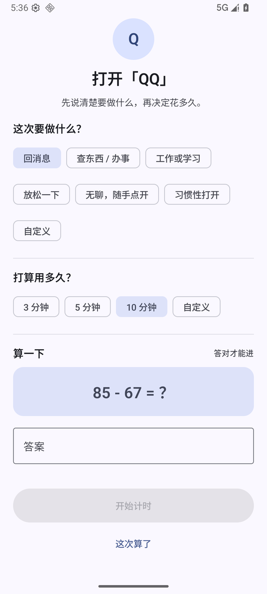
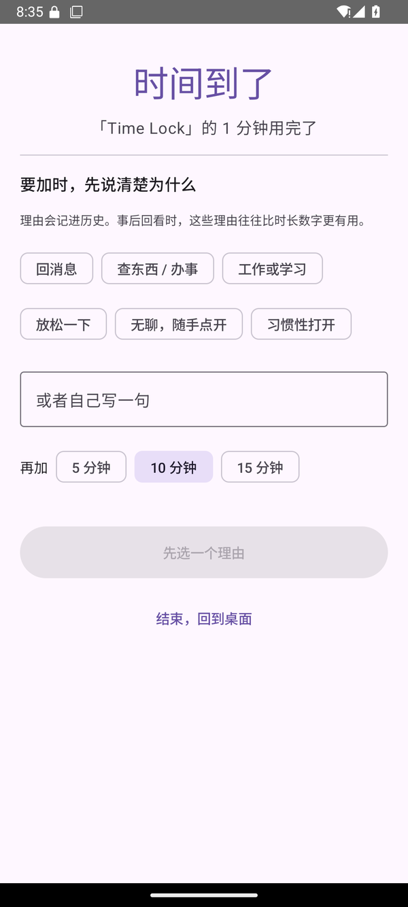
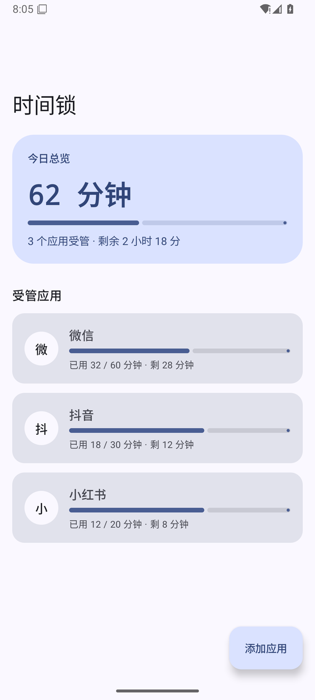
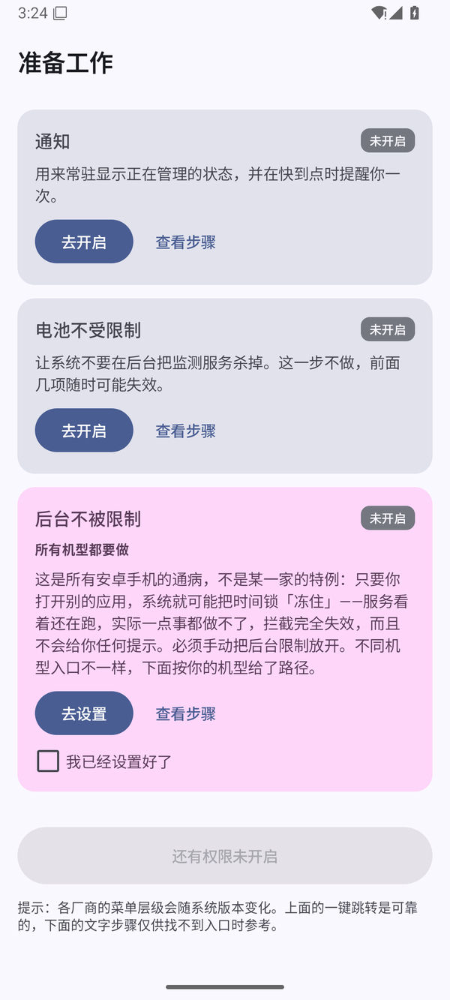
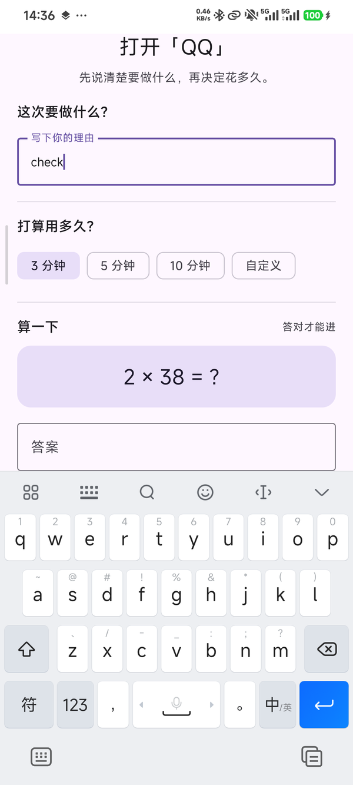

# 时间锁 · Time Lock

一个完全离线的 Android 自律工具。打开受管应用前，它先拦下来问三句话：
**这次要做什么 → 打算用多久 → 算一道题**（最后一道可以在设置里关掉）。答完才放行，时间到就锁住。

`Kotlin` · `Jetpack Compose` · `Material 3` · `minSdk 26` · `无联网权限` · `当前版本 2.1`

<p align="center">
  
</p>
<p align="center"><sub>打开受管应用时。上一段没填完，下一段根本不会出现</sub></p>

---

## 下载

**[时间锁 2.1（TimeLock-2.1.apk，9 MB）](https://github.com/kokoroyi/TimeLock/releases/latest)**

- 支持 Android 8.0（API 26）及以上，arm64 / x86_64 通用
- SHA-256：`9f30fbf3662e1846b59ac05bd2efa19777c8d7920344579be46704bd3401eab8`
- 装好后第一次打开会走权限向导。**最后那项「后台不被限制」必须做**：去应用信息页把省电策略改成无限制，
  不做的话服务会被系统冻结，界面看起来正常，实际拦不住

## 为什么做这个

真正需要被拦住的只有开头那几秒。一旦进去了，想退出来靠的就不是设计，而是意志力。

所以力气全花在入口：不让你「三下连点就进去了」。拦截页改成逐段解锁，上一段没填完下一段根本不存在，
最后再算一道口算题。它起的是减速带的作用——不指望拦住谁，只是把「无意识点开」变成「有意识进入」。

## 界面

### 一、拦截：三段依次解锁

| 步骤 | 完成条件 | 未完成时 |
|---|---|---|
| ① 这次要做什么？ | 选中任一标签，或在输入框里写下非空理由 | 永远存在，是唯一必填项 |
| ② 打算用多久？ | 选 3 / 5 / 10 分钟，或输入自定义分钟数 | 整段不渲染 |
| ③ 算一下 | 口算答案正确（设置里可关） | 整段不渲染 |

三段全部满足，「开始计时」才可点。

锁住的段落是**整段不存在**，不是变灰。变灰的控件照样占位、照样吸引视线，等于把答案摆在你眼前。
出现时带 220ms 展开动画，并自动滚进可见区域：真机上键盘占掉半屏，不滚的话新段落落在键盘外面，
屏幕上看起来什么都没变，用户会以为卡死。

### 二、到点：先写理由，再给时间

<p align="center">
  
</p>

到点后想继续，必须选一个理由或自己写一句，理由会连同这次使用一起进历史。
事后回看时，「又是无聊随手点开」这种记录比「用了 12 分钟」有用得多。

### 三、首屏与权限向导

| 首页 | 权限向导 |
|:---:|:---:|
|  |  |
| 今天的总额度、每个应用的进度，一眼看完 | 4 项系统授权 + 1 项后台设置，每一项都写清为什么要它 |

最后那项「后台不被限制」和前面四项刻意做得不一样：系统没有接口能检测它，只能你自己去设置里确认。

### 真机

<p align="center">
  
</p>

Android 16 / HyperOS 3 / Redmi K70，拦截 QQ。这是使用中的真实状态：没有标签时直接给输入框，
键盘弹起来之后新出现的段落会自动滚上来。

## 功能一览

| 能力 | 说明 |
|---|---|
| 拦截 | 前台服务每 500ms 轮询 `UsageStatsManager`，命中受管应用就用 `TYPE_APPLICATION_OVERLAY` 盖上 Compose 界面 |
| 三段逐段解锁 | 见上文，链式条件按累积判断（前面全完成才出现下一段） |
| 计算验证码 | 百以内四则口算，默认开启、可关；题库按契约枚举，共 5703 道 |
| 额度 | 3 / 5 / 10 分钟，或自定义 |
| 到点提醒 | 默认提前 5 分钟，实际提前量 = `min(设置值, 总时长 ÷ 3)`，短额度不会一开计时就响 |
| 加时 | 必须选或写理由，理由落进历史 |
| 白名单 | 把导航、支付、电话这类不该被拦的应用放进去，永不拦截 |
| 使用历史 | 每次打开留下用途、时长、是否加时，并按今日 / 本周 / 全部汇总「反身性打开」的比例 |
| 权限向导 | 按小米 / vivo / OPPO 分支给出入口与文字步骤，支持自检缺哪一项 |
| 外观 | Material 3、跟随系统壁纸取色、深色模式三档（跟随 / 常亮 / 常暗） |

## 几个值得记的实现细节

**链式判断必须累积。** 最早只判断「紧邻上一段是否完成」，结果用户回头取消用途时，第二段收起了、
第三段却还赖在屏幕上。现在每一段的开关都写着「前面全部完成」这个条件。

**键盘会把新段落挡住。** `AnimatedVisibility` 展开的内容可能在键盘外侧，用户看不到任何变化。
每个门控段落外包一层 `BringIntoViewRequester`，展开后延迟一帧请求滚动。

**口算难度有契约，不是随机数。** 目标是「能靠心算做出来，但不能靠本能答出来」，五条规则：

1. 全部整数、百以内、除法必须整除
2. 操作数与答案都 ≥ 2，排除 `x ÷ x`、`x ÷ 1`、`x × 1`
3. 每道题至少一边是两位数（≥ 11），排除九九乘法表
4. 不允许出现整十：`3 × 20`、`90 ÷ 3`、`73 + 20` 都是「算一位数再补个零」
5. 不允许 11 的乘除、不允许同十位相减：`4 × 11 = 44`、`75 − 73 = 2`

题库在启动时按契约枚举出来再均匀抽取（加 2628 / 减 2916 / 乘 85 / 除 74），
而不是「就地随机 + 重试」：乘除法可选范围极窄，就地随机会让独苗题反复出现，被记住。现在单道题最高只占 0.34%。

**短额度不提前提醒。** 3 分钟额度用 `min(5, 3÷3) = 1` 分钟提前量；1 分钟额度干脆不提醒。

## 技术栈

| 项 | 选择 |
|---|---|
| 语言 | Kotlin 2.4.21 |
| UI | Jetpack Compose（BOM 2026.09.00）+ Material 3 |
| 构建 | AGP 9.4.1 / Gradle 9.8.1 / JDK 21 |
| SDK | minSdk 26 · targetSdk 36 · compileSdk 37 |
| 存储 | DataStore Preferences + kotlinx.serialization（没有数据库，没有注解处理器） |
| 依赖注入 | 手写容器 `AppContainer`，不引 Hilt |
| 网络 | 无。清单里没有 `INTERNET` 权限 |

## 构建

```bash
git clone https://github.com/kokoroyi/TimeLock.git
cd TimeLock
./gradlew assembleDebug
```

需要 JDK 21（Android Studio 自带的 jbr 即可）与 Android SDK Platform 37。
用 Android Studio 直接打开工程更省事，首次同步会自己生成 `local.properties`。

发布签名是可选的，做法见 [docs/signing.md](docs/signing.md)；没有签名配置时 release 一样能构建，只是产出未签名 APK。

不想自己构建的话，直接用上面 [Releases](https://github.com/kokoroyi/TimeLock/releases/latest) 里的安装包。

## 目录结构

```
app/src/main/java/com/timelock/app/
├── data/      DataStore：设置、使用历史
├── domain/    模型、会话状态机、口算题库（不依赖 Android）
├── service/   前台监测服务、悬浮窗控制
├── system/    前台应用检测、权限检查、机型适配文案
└── ui/        Compose 界面：首页 / 拦截 / 加时 / 历史 / 选择应用 / 权限向导 / 设置
```

## 版本

版本号规则与每个版本的变更明细都在 [CHANGELOG.md](CHANGELOG.md)。当前 `2.1`（versionCode 3）。

## 已知限制

- 依赖系统授权。缺「使用情况访问」或「悬浮窗」任意一项，拦截就会时好时坏。
- 国产 ROM 会冻结后台应用，必须在应用信息页把「省电策略」改成无限制，否则服务看着还在跑、实际什么也做不了。
  权限向导的第 5 项专门处理这件事，但这一步没有任何系统接口可以检测，需要你自己确认。
- 只在 Android 16（Redmi K70 / HyperOS 3）和 Android 16 模拟器上实测过。代码按 26 起的通用 API 写，更老的版本没有测试。
- 没有数据导出、免打扰时段、桌面小组件，这些在后续计划里。

## 隐私

应用没有 `INTERNET` 权限，清单里也没有任何联网组件，断网可完整使用。
所有设置与记录只保存在本机 DataStore 中，卸载即清空。

## 许可

[MIT](LICENSE)

---

时间锁 2.1 · 最后更新 2026-11-12
